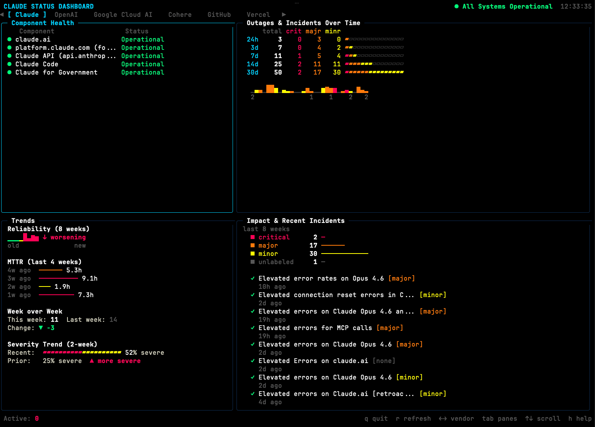
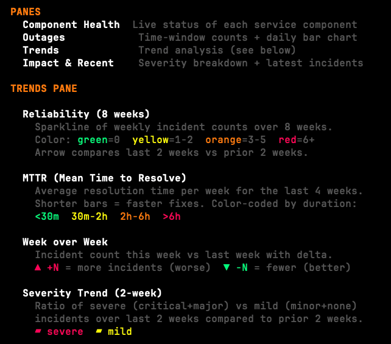
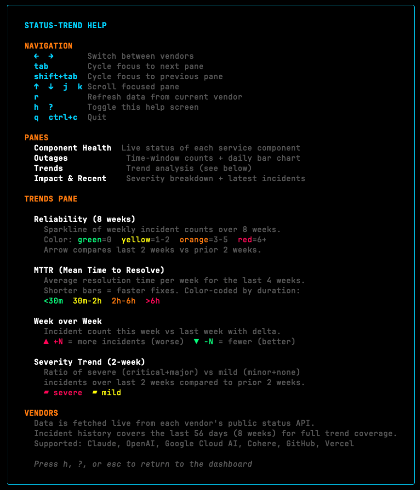
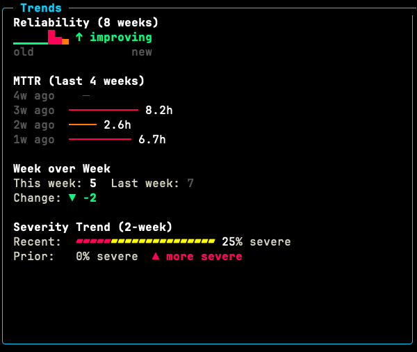

# status-trend

A terminal dashboard that visualizes outage and incident data from multiple vendor status pages. Built with [Bubble Tea](https://github.com/charmbracelet/bubbletea) and [Lip Gloss](https://github.com/charmbracelet/lipgloss).



## Supported Vendors

- Claude
- OpenAI
- Google Cloud AI
- GitHub
- Vercel

## Installation

### Prerequisites (macOS)

If you don't have Homebrew installed, install it first:

```bash
/bin/bash -c "$(curl -fsSL https://raw.githubusercontent.com/Homebrew/install/HEAD/install.sh)"
```

### Install via Homebrew

```bash
brew install aflansburg/tap/status-trend
```

### Install from Source

Requires Go 1.26+:

```bash
git clone https://github.com/aflansburg/status-trend.git
cd status-trend
go build -o status-trend .
```

## Usage

```bash
status-trend
```


### Dashboard Panes

The dashboard is organized into four panes:

| Pane | Description |
|------|-------------|
| **Component Health** | Live status of each service component |
| **Outages & Incidents** | Time-window counts + daily incident bar chart |
| **Trends** | Reliability sparklines, MTTR, week-over-week, severity trends |
| **Impact & Recent** | Severity breakdown + latest incidents |



### Keyboard Shortcuts

| Key | Action |
|-----|--------|
| `Left` / `Right` | Switch between vendors |
| `Tab` / `Shift+Tab` | Cycle focus between panes |
| `Up` / `Down` / `j` / `k` | Scroll focused pane |
| `r` | Refresh data |
| `h` / `?` | Toggle help screen |
| `q` / `Ctrl+C` | Quit |

Mouse support is also available: click to focus panes, click vendor names to switch, and scroll within panes.



### Trends Pane

The Trends pane provides deeper analysis over the last 8 weeks of incident data:

- **Reliability**: Weekly incident count sparkline, color-coded by severity (green = 0, yellow = 1-2, orange = 3-5, red = 6+)
- **MTTR**: Mean Time to Resolve per week, color-coded by duration
- **Week over Week**: Incident count delta between current and previous week
- **Severity Trend**: Ratio of severe vs mild incidents over a 2-week rolling window



## Recording Metrics

By default `status-trend` keeps nothing — data lives in memory and is discarded on exit. You can optionally record each fetch to a local [SQLite](https://www.sqlite.org/) database, then analyze real metrics over time with [DuckDB](https://duckdb.org/). Recording is off unless you ask for it.

| Flag / env | Effect |
|------------|--------|
| `--record` | Record every fetch while the dashboard runs |
| `--once` | Fetch all vendors once, record, print a summary, and exit (implies `--record`) |
| `--db <path>` | Metrics database path (overrides the env var and default) |
| `STATUS_TREND_DB` | Metrics database path (overrides the default) |

The default path is `metrics.db` under your OS config directory — on macOS, `~/Library/Application Support/status-trend/metrics.db`.

```bash
# Record while you browse the dashboard
status-trend --record

# One-shot record, suitable for cron / launchd
status-trend --once
```

Each recording upserts incidents (keyed by vendor + incident ID) and adds a timestamped snapshot of overall status and per-component status. Because the dashboard is interactive, the time series is sparse; schedule `status-trend --once` (e.g. hourly via cron or launchd) to build dense history.

The database uses WAL mode, so a `metrics.db-wal` and `metrics.db-shm` sidecar file appear next to it. That is expected.

### Querying with DuckDB

DuckDB reads the SQLite file directly:

```sql
INSTALL sqlite; LOAD sqlite;
ATTACH 'metrics.db' AS m (TYPE sqlite);

-- Incidents per vendor per ISO week
SELECT vendor, strftime(CAST(created_at AS TIMESTAMP), '%Y-W%W') AS week, count(*)
FROM m.incidents WHERE created_at IS NOT NULL
GROUP BY 1, 2 ORDER BY 1, 2;

-- MTTR per vendor, in hours (resolved incidents only)
SELECT vendor,
       avg(epoch(CAST(resolved_at AS TIMESTAMP)) - epoch(CAST(started_at AS TIMESTAMP))) / 3600 AS mttr_hours
FROM m.incidents
WHERE resolved_at IS NOT NULL AND started_at IS NOT NULL
GROUP BY 1;

-- Component uptime: share of snapshots where a component was operational
SELECT vendor, name,
       avg(CASE WHEN status = 'operational' THEN 1.0 ELSE 0 END) AS uptime_ratio
FROM m.component_status WHERE is_group = 0
GROUP BY 1, 2 ORDER BY uptime_ratio;
```

Times are stored as RFC3339 UTC text. If a read looks stale while the app is writing, run `PRAGMA wal_checkpoint(TRUNCATE);` against the SQLite file first.

## How It Works

Data is fetched live from each vendor's public status API. Most vendors use the [Atlassian Statuspage](https://www.atlassianstatuspage.com/) format. Google Cloud AI uses a dedicated implementation due to its different API structure. Incident history covers the last 56 days (8 weeks) for full trend coverage.

## License

MIT
